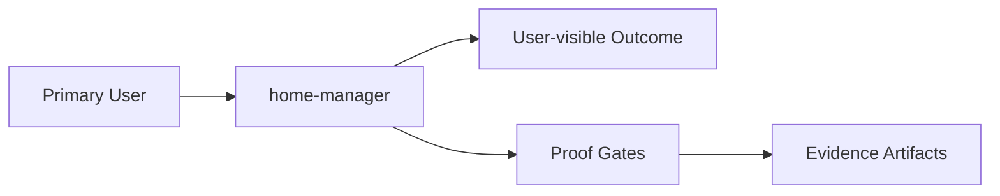

# Intent

## Product Outcome
- Reproduce and update the host configurations through Nix, Home Manager, nix-darwin, nix-on-droid, and Guix, with explicit deployment and rollback procedures.
- Keep coding agents on approved model routes. Reduce token cost without losing source fidelity, prompt-cache reuse, authentication, recovery, or private memory boundaries.
- In Doom Emacs, type `jk` to leave Evil insert state. Toggle `SPC t z` for a centered 80-column writing area, or `SPC t Z` to use the same focused layout while full-screening the Emacs frame.
- On M-02877, pi is wired to the team services in LEGO/devrel-infra: Chorus (built-in MCP, `chorus-pi`, and a wakeable `chorus daemon --agent pi` serving `~/projects`), Beads (`pi-beads-extension` for agent context; `pi-tasks` was removed on 2026-10-08), the personal Signet for every Signet client (the memory curator publishes team-level memories to the team Signet and mirrors the team pool back, every ten minutes), and the LEGO TechWriter toolbox (toolbox-docs skills replace the hand-copied ones, plus a `techwriter` pi agent that reads the LEGO style guide from Copilot Spaces).
- On Mahakala, use `just deploy-mahakala` to update and apply the Guix System, Guix Home, and Home Manager profiles. The boot configuration also requests the ath10k warm-only reset mode for the verified QCA6174 card.
- On mahakala, GDM starts EWM through Home Manager's `ewm-start`. Nix supplies both Emacs and `ewm-core`, which must use compatible glibc versions.

## What This Project Is
Den is the configuration repository for the user's workstations, servers, and mobile deploy targets.
`flake.nix`, `modules/`, the Guix files, and `Justfile` define their packages, services, agent integrations, and deployment procedures.
Shared gateway facts have one owner in `gateway.json`; each host and harness adapts those facts without embedding credentials.

Key operating facts:
- **Primary languages**: Nix, Guile, and shell
- **Supporting surfaces**: Go checks, Python helpers, and TypeScript or JavaScript agent integrations

## Product View

## Inferred Baseline
- Repository: home-manager
- Product type: service_or_library
- Primary languages: shell
- Detected surfaces: shell

## Scope
| Area | In Scope | Proof Surface |
|---|---|---|
| Core workflow | Define a concrete user-visible workflow | Acceptance criteria + tests |
| Data contracts | Document canonical inputs/outputs | [INTERFACES.md](./INTERFACES.md) and schema checks |
| Delivery quality | Block promotion on broken proof surfaces | [VALIDATION.md](./VALIDATION.md) blocking gates |

## Non-Goals (Falsifiable)
| Non-goal | How to falsify |
|---|---|
| Feature creep beyond the primary outcome | Any PR adds capability not tied to outcome criteria |
| Shipping without evidence | Missing validation artifacts for promoted changes |
| Ambiguous ownership boundaries | Missing owner/system-of-record in interfaces |

## Constraints
- Technical: runtime, dependency, and topology boundaries are explicit.
- Operational: deployment, rollback, and incident ownership are defined.
- Security/compliance: sensitive data handling and authz are mandatory.

## Acceptance Criteria (must be objectively testable)
- [ ] Decapod validate passes, required tests pass, and promotion-relevant artifacts are present.
- [ ] The M-02877 Claude and OpenAI routes preserve protocol shape, bearer authentication, project attribution, and direct escape routes.
- [ ] Provider activation preserves user credentials, model catalogs, extra headers, and unrelated providers; repeated activation has the same result.
- [ ] Token-chain changes have separate evidence for installed versions, live readiness, cache reuse, exact recovery, and private memory boundaries.
- [ ] Reviewer installation preserves host settings and leaves risk acceptance and feature activation to the operator.
- [ ] The Home Manager managed Doom config enables `:ui zen`, sets its writing width to 80 columns, and configures Evil escape as `jk`.
- [ ] Doom's buffer and full-screen Zen toggles keep writing text centered at the configured width and can be toggled off.
- [ ] Mahakala deployment recipes read Guix source files from the active Justfile directory, including an isolated worktree.
- [ ] Mahakala's Guix System kernel arguments include `ath10k_pci.reset_mode=1` for PCI device `168c:003e` using `ath10k_pci`.
- [ ] Guix System, Guix Home, and Home Manager profiles build and apply through `just deploy-mahakala` without changing another host.
- [ ] The deployment does not force an immediate reboot. The next planned boot supplies runtime proof for the Wi-Fi recovery trial.
- [ ] Non-functional targets are met (latency, reliability, cost, etc.).
- [ ] Validation gates pass and artifacts are attached.
- [ ] Repository test/lint/typecheck commands are defined and wired into CI.

## Epistemic Custody Fields

### Active Assumptions
- [ ] List any assumptions made to proceed.
- [ ] Flag assumptions that require future verification.

### Confidence & Risk Level
- **Confidence**: Low/Medium/High (Rationale: )
- **Risk**: Low/Medium/High (Impact of wrong assumptions: )

### Measured vs Inferred Facts
| Fact | Source (Provenance) | Type (Measured/Inferred) |
|---|---|---|
| PCI device `02:00.0` is QCA6174 `168c:003e` and uses `ath10k_pci` | `lspci -nnk` on Mahakala | Measured |
| `ath10k_pci.reset_mode=1` selects warm-only reset; `0` selects automatic reset | Built module `modinfo` and upstream Linux driver source | Measured |

### Unresolved Contradictions
- [ ] List any evidence that conflicts with current assumptions or intent.

### Deferred Questions
- [ ] Questions to be answered later.

### Stop Conditions
- [ ] Explicit conditions under which the agent should stop and ask for help.

### Proof Required Before Completion
- [ ] Record successful Guix System, Guix Home, and Home Manager profile application on Mahakala.
- [ ] Confirm the active system generation contains the new kernel argument. Do not force a reboot during deployment.
- [ ] Inspect ath10k probe logs after the next planned boot. Treat the parameter as a recovery trial until that boot succeeds.

## Tradeoffs Register
| Decision | Benefit | Cost | Review Trigger |
|---|---|---|---|
| Simplicity vs extensibility | Faster iteration | Potential rework | Feature set expands |
| Strict gates vs dev speed | Higher confidence | More upfront discipline | Lead time regressions |

## Secret Prompt Budget (M-02877)
Reading secretspec secrets on M-02877 raises no dialog, even after a
secretspec rebuild. The committed store must stay confidential in a public
repository against later cryptanalysis, so every recipient is post-quantum.
The decryption key must not be exportable from the machine. The user accepts
that any process running as them on that Mac can decrypt without a dialog.
A backup key held only in a password manager is the recovery path.

## Deploys Must Not Damage Apps
A failed Homebrew cask upgrade during `just deploy-darwin` must stop before it
can touch the app. It must not leave an app half-deleted, as happened to
ChatGPT.app, or empty, as happened to ChatGPT.app again once the user lost
admin-group membership and `/Applications` became read-only to them. Casks the
user cannot upgrade in place move to `~/Applications` automatically. Fixes that
need admin rights are one command the user runs, and they change ownership only
or delete an unused old copy. The guard stops a deploy only for a cask that
`brew bundle` upgrades. An app that device management updates in place, such as
Visual Studio Code or Logseq under Jamf, has one updater: den does not
install it as a cask, so it cannot stop a deploy. A cask that installs a macOS package must
upgrade during an unattended deploy. A deploy must not stop halfway, with `/etc`
changed and Home Manager not activated.

## Pull Requests Merge Only Within Fixed Rules
The target is no open pull request without the `hold` label and no open issue
without the `needs-human` label (plan
`docs/plans/2026-10-30-001-dagger-ci-autonomous-merge-plan.md`). A pull
request merges without a person only when the merge rules of
`.dagger/modules/ci/automerge.go` accept its exact head. The rules require an
allowed author, no stop label, no risky path, a clean review of that head,
and checks that are all complete and green. Branch protection on `main`
requires the checks `den/dagger-check` and `validate`, and the rules also
refuse until GitHub reports that branch protection lets the head merge. Each
refusal names its rule and its reason. A pull request from an author outside the list gets the checks
only. The shepherd asks the Codex connector to review each new head, so a
head does not wait for a person to ask (plan P3). The shepherd merges by
itself (plan P4, step 2): in each run it merges at most one pull request that
the rules accept, and it pins the merge to the head commit that it judged. A
merge changes the base of the other pull requests, so the next run judges them
again. Step 2 started after 10 pull requests where the report of the shepherd
agreed with the merge (bead home-manager-1l3.5). To stop live merges, remove
`--merge` from `.github/workflows/shepherd.yml`, or label a pull request
`hold`. The flake inputs change only through the nightly bump PR, so a
deploy of M-02877 uses only inputs that CI checked (plan P6).

## First Implementation Slice
- [ ] Define the smallest user-visible workflow to ship first.
- [ ] Define required data/contracts for that workflow.
- [ ] Define what is intentionally postponed until v2.

## User and Actor Contract
- Primary user/agent:
- Authorized actors and their allowed mutations:
- Preconditions required before the primary workflow:
- Observable success result:
- Observable failure result and recovery action:
- Human decision points that automation must not infer:

## Outcome Decomposition
| Outcome | Trigger | State Written | Evidence | Owner |
|---|---|---|---|---|
| Primary outcome | | | | |
| Safety/quality outcome | | | | |
| Operational outcome | | | | |

## Change Impact Rules
- A change to user intent updates this document and acceptance criteria.
- A change to a runtime boundary updates [ARCHITECTURE.md](./ARCHITECTURE.md).
- A change to a callable or persisted contract updates [INTERFACES.md](./INTERFACES.md).
- A change to proof or promotion behavior updates [VALIDATION.md](./VALIDATION.md).
- A breaking change requires an explicit migration trigger, compatibility note,
  rollback condition, and an agent-facing instruction.

## Open Questions (with decision deadlines)
| Question | Owner | Deadline | Decision |
|---|---|---|---|
| Which interfaces are versioned at launch? | TBD | YYYY-MM-DD | |
| Which non-functional target is hardest to hit? | TBD | YYYY-MM-DD | |

## Limited NAS Recovery

The repository supplies code and tests for the approved NAS recovery set. `scripts/fleet-maintenance/mother_recovery.py` prepares configuration and application data from mother. The user selected loving-kypris as the destination. Bulk media, downloads, Docker images, and the Drive internal repository stay outside this scope.

An encrypted backup must pass an independent read and restore test before the operator deletes its plaintext source copies. A local Btrfs snapshot does not protect against loss of the NAS. A partial restore test does not prove a full NAS rebuild or a supported DSM downgrade.

Dagger tests repository code and policy. Swamp will coordinate the private operational workflow after its safety gates pass. Credentials, source archives, and detailed runtime evidence stay outside public CI and team memory. Swamp must use an observer that survives target reboots and WAN loss before unattended installation starts.

<!-- decapod:declared-capabilities:start -->

## Declared Capability Surfaces

These declarations select authoring and proof obligations; they do not attest implemented runtime guarantees.

- `infrastructure-management`
- `secrets-handling`

<!-- decapod:declared-capabilities:end -->

<!-- decapod:codebase-attestation:start -->

## Codebase Attestation

- Repository signal fingerprint: `1f0e237bebd028d6cce308b8d565edab214343d8e3160673040e1cdaf6af1404`
- Significant implementation surfaces: `.beads/` (1 files), `.dagger/` (12 files), `.github/` (5 files), `README.md/` (1 files), `docs/` (2 files), `modules/` (1 files), `scripts/` (9 files), `terraform/` (1 files)
- Refreshed from the current codebase by `decapod rpc --op specs.refresh`
<!-- decapod:codebase-attestation:end -->
